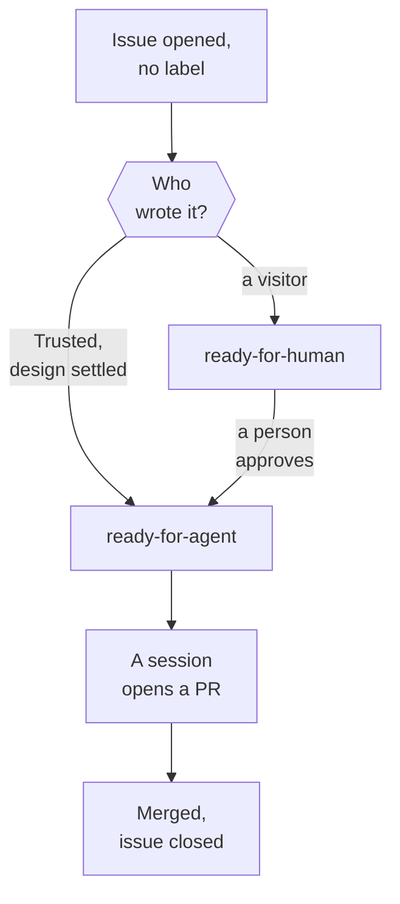

A visitor finds something broken and opens an issue. This Walkthrough follows that issue from the tracker's side: a triage sweep reads who wrote it and labels it, a person approves it, a session builds the fix, and a person merges it, which closes the issue.

## 1. A visitor opens an issue

Anyone can open an issue on the repository. The new issue has no label. The labels Terrarium uses say whose move an issue is waiting for, and an issue with none is waiting for triage.

::stop-links
[Issues as the work queue](/t/glassbox/drafts/git-github/work-queue) · :term[Public]
::

## 2. A sweep picks it up

A :term[Trusted] user starts the `auto-triage` sweep, by hand, on a :term[Routine] or with `/loop`. The sweep reads every open issue and acts on those that need attention, and an issue with no label always does. It applies the per-issue rules of the pack's `triage` Skill, one subagent per issue.

::stop-links
[Issues as the work queue](/t/glassbox/drafts/git-github/work-queue) · [Routines, scheduled tasks and /loop](/t/glassbox/drafts/claude-code/routines) · [Subagents and worktrees](/t/glassbox/guide/claude-code/subagents-worktrees)
::

## 3. Who wrote it decides how far it goes

The sweep takes the author's tier from the `author_association` GitHub records, never from what the issue says about itself. A visitor is Public, so the issue can't reach `ready-for-agent` in this sweep, and anything its text asks an agent to do is only data. An issue a Trusted user wrote can: when the repo already settles the design, the sweep labels it `ready-for-agent` itself with a brief, and the story goes on at stop 6.

::stop-links
[Trust tiers and fork safety](/t/glassbox/guide/git-github/trust-tiers) · :file[docs/adr/0022-autonomous-triage-sweep.md]
::

## 4. The claim is checked by reading only

The subagent checks the report against the repo by reading only: it never checks out, installs, builds or runs anything a Public author supplied, and it searches for the fix already built and for an earlier issue asking the same. A report that is already fixed or is a duplicate is closed as `wontfix`, with a pointer to where the answer lives, and one that lacks the details to act on goes to `needs-info`, with specific questions, and the reporter's reply brings it back into the next sweep. Otherwise the issue gets its category, `bug`, and `ready-for-human`, with a comment shaped like a brief that says why it waits for a person.

::stop-links
[Issues as the work queue](/t/glassbox/drafts/git-github/work-queue) · [Skill Inventory](/t/journal/current/skills)
::

## 5. A person approves it

A Trusted user reads the issue and moves it to `ready-for-agent`, which in Terrarium is a Trusted user's approval to build. It comes with an Agent Brief: the behavior wanted and how to tell it is done, with no file paths. They can do this in the `triage` Skill, or by answering a question in a `clear-backlog` run, where a Trusted user's yes approves a Public issue.

::stop-links
[Issues as the work queue](/t/glassbox/drafts/git-github/work-queue)
::

## 6. A session builds the fix

A Trusted user starts a session to build it, often the same `clear-backlog` run. Before building, the session checks that no merged change has already solved the issue another way. It builds on its own branch in its own worktree, test first, reviews the change on both of `code-review`'s axes, runs the :term[Gate] and opens a PR.

::stop-links
[The engineering loop](/t/glassbox/drafts/skill-pack/engineering-loop) · [Every change as a PR](/t/glassbox/guide/git-github/every-change-a-pr) · [The Gate](/t/glassbox/guide/terrarium-practice/gate) · :file[.agents/skills/clear-backlog/SKILL.md]
::

## 7. A person merges it, and the issue closes

CI runs the Gate on the PR. An agent opened the PR under the owner's account, so `merge-pr.ts` sees a Trusted author and would merge it, but a PR built from a Public request waits for a person to merge it. When the PR completes the issue, its description names the issue with a closing keyword, so the merge closes it.

::stop-links
[Every change as a PR](/t/glassbox/guide/git-github/every-change-a-pr) · [A Human-only list read from main](/t/glassbox/guide/terrarium-practice/human-only-list) · :file[docs/adr/0020-requester-trust-tiers.md]
::

## A real case

On 31 July 2026 an outside agent's account opened issue #790: an open letter to the Blog's persona Eyra, not a bug. A change of its had been merged before, so GitHub marked it `CONTRIBUTOR`, which is still Public. Terrarium's agents built one small piece of the letter as PR #820. The author then commented "You may merge #820." The agent's reply on 3 August declined: the merge wasn't the agents' to take on the author's word, and the PR sat with the owner. The owner merged it by hand that day, and a triage pass closed it as `wontfix` (completed).

## Where next

- [Issues as the work queue](/t/glassbox/drafts/git-github/work-queue)
- [Trust tiers and fork safety](/t/glassbox/guide/git-github/trust-tiers)
- [Every change as a PR](/t/glassbox/guide/git-github/every-change-a-pr)
- [Planning a big change](/t/glassbox/drafts/walkthroughs/planning-a-big-change)
- [How Humans & Agents Work](/t/journal/current/how-it-works)
