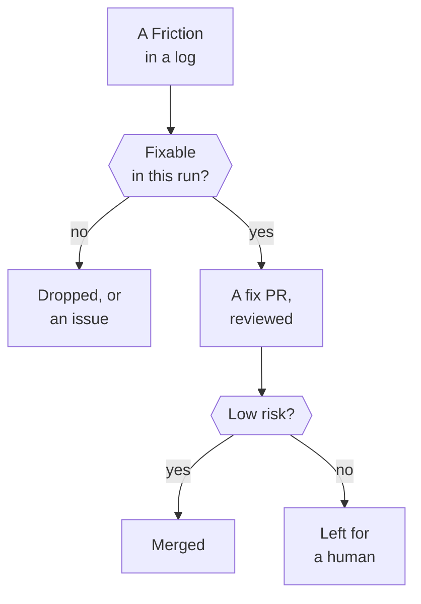

No one reads every session to fix what went wrong in it. Each session reports its own pain-points instead, and a scheduled agent turns the ones that recur or cost the most into fixes. This Walkthrough follows one Friction from the session that hit it, through that agent's run, to the changed instruction a later session reads.

## 1. A session hits a Friction

Something costs a session effort: a doc misled it, a tool call was refused, a step was missing. When the session logs its work, it records every :term[Friction], each with a description, a possible fix and a severity from `nit` to `blocker`, small ones too.

::stop-links
[Session logs and Frictions](/t/glassbox/guide/terrarium-practice/session-logs)
::

## 2. The log lands on `main`

A hook commits the :term[session log] straight to `main`, without a PR. The Friction is on record from then on, whether or not the session's own work ever merges.

::stop-links
[Session logs and Frictions](/t/glassbox/guide/terrarium-practice/session-logs)
::

## 3. A Routine starts `frictions-to-fixes`

A :term[Routine] starts a session that runs the `frictions-to-fixes` Skill, or a Trusted user runs it by hand. It is a session like any other, following the Skill's steps.

::stop-links
[Scheduled tasks](/t/glassbox/guide/claude-code/routines) · [Claude Code Skills](/t/glassbox/guide/claude-code/skills) · :file[.agents/skills/frictions-to-fixes/SKILL.md]
::

## 4. A subagent reads the logs

One subagent reads the logs and hands back a short ranked report. It reads every log in a recent window and files each matching Friction under an entry of the :term[Friction Ledger]: one entry per root cause, with every session that hit it. It commits those Ledger changes and changes nothing else.

::stop-links
[Subagents](/t/glassbox/guide/claude-code/subagents) · [Friction Ledger](/t/journal/current/frictions) · :file[scripts/session/extract-frictions.ts] · :file[layers/journal/content/current/frictions/]
::

## 5. It screens out what a fix can't help

The subagent drops a Friction that a merged change already fixed, one that an open issue or PR already tracks (unless it has sat idle), one inside an instruction that a :term[Prune Trial] is testing, and one that only an edit to an outside pack Skill could fix. A Friction that came back after its fix merged is a regression: the run files an issue that names the fix that failed, and doesn't try the same fix again.

::stop-links
[Prune Trials](/t/glassbox/drafts/terrarium-practice/prune-trials) · [Skill packs](/t/glassbox/guide/skill-pack/skill-packs) · :file[scripts/git/list-merges-since.ts]
::

## 6. The run picks what to fix

The run weighs recurrence and severity together and picks the top candidates, and one design subagent reads each occurrence's full log and designs every fix. For a Friction that a doc already covers, it checks whether the session had opened that doc: if not, the instruction sits where nobody looks; if so, its wording failed. A fix that would touch a :term[Human-only] file, a guard or the hook wiring, or that turns on a design choice a person should make, is never built in this run: it gets an issue with the design instead.

::stop-links
[Protected paths](/t/glassbox/guide/terrarium-practice/human-only-list) · [Blocking hooks](/t/glassbox/guide/claude-code/blocking-hooks) · [Issue triage labels](/t/glassbox/guide/git-github/work-queue) · :file[.agents/skills/frictions-to-fixes/design-brief.md]
::

## 7. Helper agents write the fixes

Helper agents write the fixes, each in a git worktree of its own, run the Gate and hand back a committed branch; they never merge. All the doc fixes go to one agent as one branch, and each code or config fix gets a branch of its own. The run's update to the Friction Ledger goes in a PR of its own, every run, fixes or none.

::stop-links
[Subagents](/t/glassbox/guide/claude-code/subagents)
::

## 8. The run reviews and merges

The run reviews each branch itself, opens its PR and posts its verdict there as a comment. A clean, low-risk fix it merges through `scripts/github/merge-pr.ts`, which refuses without that verdict and refuses a PR that changes a Human-only file. A fix whose diff needs a human merge stays open, with the reason, for a Trusted user.

::stop-links
[Merge gate](/t/glassbox/guide/verification/gate) · [Pull requests](/t/glassbox/guide/git-github/every-change-a-pr)
::

## 9. The next session reads the fix

The fix lands in a doc, a repo-owned Skill, a script or config. A later session that opens that doc or runs that Skill gets the new text, and its log lists that doc among the docs it read, or that Skill among the Skills it used. The Ledger entry records the fix's PR and the date it merged, and from then on only sessions that started after the fix count as a recurrence.

::stop-links
[Claude Code Skills](/t/glassbox/guide/claude-code/skills) · [CLAUDE.md as the every-session contract](/t/glassbox/guide/claude-code/claude-md) · [Friction Ledger](/t/journal/current/frictions)
::

## A real case

In July 2026 a session waited about two hours on a PR's CI. It had called `ScheduleWakeup` to wake it later, but that tool paces `/loop`, and nothing woke the session. An issue filed from the logged Friction added a line to an agent doc (#241), and a later `frictions-to-fixes` run added another (#425). On 31 July two scheduled sessions made the same mistake; neither had any reason to open that doc. A run filed it as a regression (#814), and the owner chose both a line in CLAUDE.md and a guard. Since PR #843, :file[scripts/hooks/loop-only-tool-guard.ts] denies a new wakeup outside `/loop`, and its message says what to use instead.

## Where next

- [Session logs and Frictions](/t/glassbox/guide/terrarium-practice/session-logs)
- [Scheduled tasks](/t/glassbox/guide/claude-code/routines)
- [Claude Code Skills](/t/glassbox/guide/claude-code/skills)
- [Asking an agent for a change](/t/glassbox/guide/walkthroughs/asking-for-a-change)
- [Friction Ledger](/t/journal/current/frictions)
