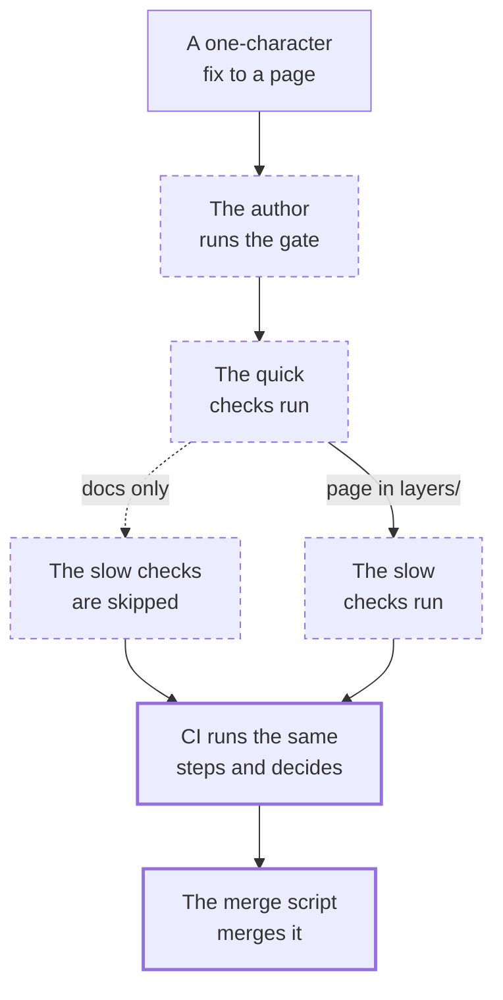

A one-character fix to the text of a Glass Box page has to pass every check the :term[gate] holds. This walkthrough follows that fix from the author's side: from the author's own run of the checks, through the quick checks, the slow checks and CI's run, to the script that merges the green PR.

## 1. The author runs the gate

An agent fixes one character in the text of a Glass Box page, a Markdown file under `layers/`. A typo is a simple change: the author reads its own diff instead of running the `code-review` :term[skill]. Then, on the final commit and before it opens the PR, it runs `pnpm gate:scoped`, the local run of the gate.

::lessons
[Pull requests](/t/glassbox/guide/git-github/pull-requests) · [Engineering skills](/t/glassbox/guide/skill-pack/engineering-skills)
::

## 2. The changed path picks the steps

`pnpm gate:scoped` diffs the branch against `main` and picks its steps from the changed paths. A docs-only change, where every changed path is :term[inert], skips the slow checks; a changed skill file skips only the build and the browser tests. A page under `layers/` is rendered content and not inert, and this change gets every step.

::lessons
[Merge gate](/t/glassbox/guide/verification/gate)
::

## 3. Lint

The quick checks, the :term[floor], open with the skills lock and the diagram check, which find nothing here: the fix changes no installed skill and no diagram. Lint runs ESLint over the repo, and ESLint has no configuration that matches a Markdown file. Run on the page alone, it skips the page with a warning, and the step has nothing to flag.

::lessons
[Linting](/t/glassbox/guide/verification/linting)
::

## 4. The type check

The type check runs Nuxt's program and the Node-side one, and neither holds a Markdown file. It passes without looking at this fix.

::lessons
[Type checking](/t/glassbox/guide/verification/type-checking)
::

## 5. Content validation

Content validation parses the page's frontmatter against its collection's schema, and checks every Glass Box page's title and description against their length caps. A fix in the body text changes neither, and the step passes.

::lessons
[Content validation](/t/glassbox/guide/verification/content-validation)
::

## 6. The unit tests

The slow checks, the :term[heavy] tier, start with the unit tests. One test per Glass Box page checks its links and its excerpts against the code at the page's pinned commit, and this page's test runs again. A typo in plain prose gives it nothing to flag; one inside an excerpt would fail it.

::lessons
[Testing](/t/glassbox/guide/verification/testing)
::

## 7. The build

`pnpm build` runs `nuxt build`. Nuxt Content parses every collection's files, this page among them, into a table per collection and saves each table as a dump. Nitro writes the whole server to `.output/`, the dumps included.

::lessons
[Content database](/t/glassbox/guide/nuxt-content/content-database) · [Nitro server engine](/t/glassbox/guide/nuxt-vue/nitro)
::

## 8. The browser tests

The browser tests serve that build and load pages from it in Chromium, among them each tenant's entry page and the pages that hold a diagram. They load this page only if one of those covers it.

::lessons
[Testing](/t/glassbox/guide/verification/testing)
::

## 9. CI runs the same steps and decides

The author pushes the commit and opens the PR. GitHub Actions runs `.github/workflows/gate.yml`, which hands every step to a composite action, a bundle of steps in a file of its own. A step in it asks `scripts/gate/gate.ts --decide` which checks to run, and for this change the answer is every one. That run, not the author's, decides whether the PR may merge.

::lessons
[GitHub Actions](/t/glassbox/guide/git-github/composite-actions) · [Merge gate](/t/glassbox/guide/verification/gate)
::

## 10. The merge script merges it

The author merges through `scripts/github/merge-pr.ts`. Before it polls the checks, the script reads the :term[human-only] list from `main` and refuses a PR that changes a listed file; this fix changes none. It then polls the PR's checks and, once every one is green, merges the PR.

::lessons
[Protected paths](/t/glassbox/guide/terrarium-practice/protected-paths) · [Pull requests](/t/glassbox/guide/git-github/pull-requests)
::

## Where next

- 
- 
- 
- 
- 
