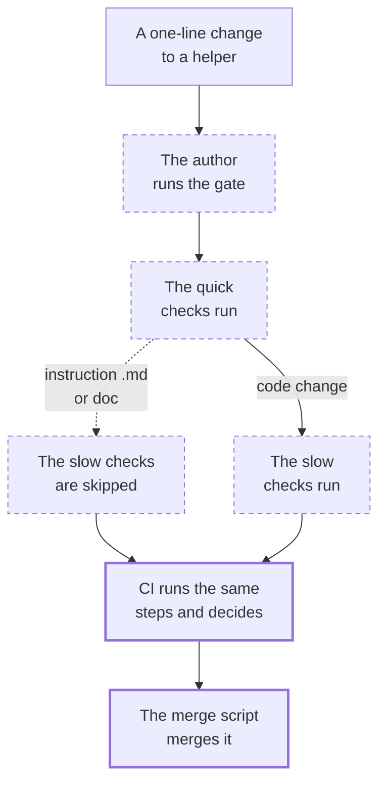

A one-line change to a TypeScript helper has to pass every check the :term[gate] holds, and most of its checks have something of their own to look at. This walkthrough follows that change from the author's side: from its review and the author's own run of the checks, through the quick checks, the slow checks and CI's run, to the script that merges the green PR.

## 1. The author runs the gate

An agent changes one line of :file[layers/journal/app/utils/duration.ts], the Journal's helper that spells out how long a session took, such as `3m 12s`. A change to code logic is never a simple change, whatever its size: the author runs the `code-review` :term[skill] on its committed diff and fixes what it finds. Then, on the final commit and before it opens the PR, it runs `pnpm gate:scoped`, the local run of the gate.

::lessons
[Pull requests](/t/glassbox/guide/git-github/pull-requests) · [Engineering skills](/t/glassbox/guide/skill-pack/engineering-skills)
::

## 2. The changed path picks the steps

`pnpm gate:scoped` picks its steps from the paths the branch changes, and this change, a `.ts` file, gets every one. A change whose every path is :term[inert], a Markdown file outside `layers/` such as an agent instruction file or a doc, or anything in `.claude/skills/`, skips the whole :term[heavy] tier. A changed skill file in `.agents/skills/` or `.claude/workflows/` skips only the build and the browser tests. A Markdown page under `layers/` skips nothing: the build renders it.

::lessons
[Merge gate](/t/glassbox/guide/verification/gate)
::

## 3. Lint

The quick checks, the :term[floor], open with the skills lock and the diagram check, which pass untouched: the change holds no installed skill and no diagram. Lint runs ESLint over the repo's code, this helper included, with Nuxt's recommended TypeScript rules set to errors. A `let` that is never reassigned fails `prefer-const`, and an import left unused fails `@typescript-eslint/no-unused-vars`.

::lessons
[Linting](/t/glassbox/guide/verification/linting)
::

## 4. The type check

The type check reads the helper as part of Nuxt's program, which holds every layer's `app/` folder. A change to the helper's parameter type fails at each call site that still passes the old one, such as the Journal code that hands it a number of seconds.

::lessons
[Type checking](/t/glassbox/guide/verification/type-checking)
::

## 5. Content validation

Content validation parses every content file against its collection's schema and checks the length of every guide page's title and description. None of its scripts loads this helper, and the step passes without looking at the change.

::lessons
[Content validation](/t/glassbox/guide/verification/content-validation)
::

## 6. The unit tests

The slow checks, the heavy tier, start with the unit tests. The helper's own spec, :file[layers/journal/tests/unit/duration.spec.ts], checks its exact text for durations under an hour and from an hour up. A change that alters any of that text, even a dropped space, fails it.

::lessons
[Testing](/t/glassbox/guide/verification/testing)
::

## 7. The build

`pnpm build` runs `nuxt build`, which compiles the app with Vite. A syntax error in the helper stops the compile, but a type error doesn't: the build checks no types. Nitro writes the server to `.output/`, with the helper bundled into its server code and into the code the browser loads.

::lessons
[Nitro server engine](/t/glassbox/guide/nuxt-vue/nitro) · [Type checking](/t/glassbox/guide/verification/type-checking)
::

## 8. The browser tests

The browser tests serve that build and load pages from it in Chromium, and fail on any console error or uncaught error while a page loads. Among them is the Journal's `current` space, whose session cards show the durations the helper writes.

::lessons
[Testing](/t/glassbox/guide/verification/testing) · :file[layers/journal/tests/e2e/journal.spec.ts]
::

## 9. CI runs the same steps and decides

The author pushes the commit and opens the PR. GitHub Actions runs `.github/workflows/gate.yml`, which hands every step to a composite action, a bundle of steps in a file of its own. A step in it asks `scripts/gate/gate.ts --decide` which checks to run, and for this change the answer is every one. That run, not the author's, decides whether the PR may merge.

::lessons
[GitHub Actions](/t/glassbox/guide/git-github/composite-actions) · [Merge gate](/t/glassbox/guide/verification/gate)
::

## 10. The merge script merges it

The author merges through `scripts/github/merge-pr.ts`. Before it polls the checks, the script reads the :term[human-only] list from `main` and refuses a PR that changes a listed file; this change touches none. It then polls the PR's checks and, once every one is green, merges the PR.

::lessons
[Protected paths](/t/glassbox/guide/terrarium-practice/protected-paths) · [Pull requests](/t/glassbox/guide/git-github/pull-requests)
::

## Where next

- 
- 
- 
- 
- 
