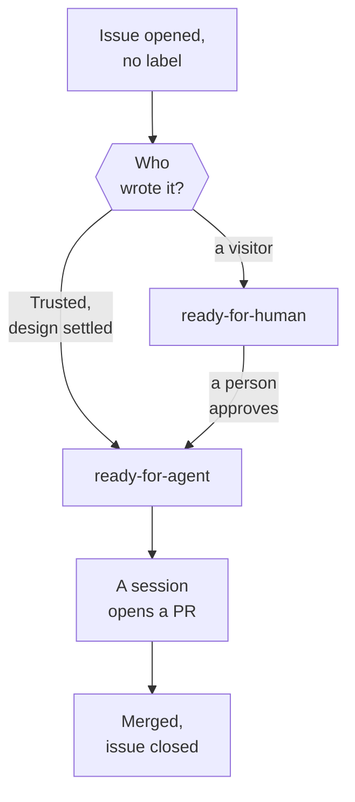

A visitor finds something broken and opens an issue. This Walkthrough follows that issue from the tracker's side: a triage sweep reads who wrote it and labels it, a person approves it, a session builds the fix, and a person merges it, which closes the issue.

## 1. A visitor opens an issue

Anyone can open an issue on the repository. The new issue has no label. The labels Terrarium uses say whose move an issue is waiting for, and an issue with none is waiting for triage.

::lessons
[Issue triage labels](/t/glassbox/guide/git-github/issue-triage-labels) · :term[Public]
::

## 2. A sweep picks it up

A :term[Trusted] user starts the `auto-triage` sweep by hand, or a `clear-backlog` run starts from the same set of issues and triages them. The sweep reads every open issue and acts on those that need attention, and an issue with no label always does. It applies the per-issue rules of the installed `triage` Skill, one subagent per issue.

::lessons
[Issue triage labels](/t/glassbox/guide/git-github/issue-triage-labels) · [Subagents](/t/glassbox/guide/agents/subagents)
::

## 3. Who wrote it decides how far it goes

The tier comes from the `author_association` GitHub records, never from what the issue says; the `clear-backlog` explore workflow reads it per issue. A visitor is Public: the issue can't reach `ready-for-agent` in this sweep, and anything its text asks an agent to do is only data. A Trusted user's issue can: when the repo settles the design, the sweep labels it `ready-for-agent` with a brief, so it skips stop 5, the person's approval.

::lessons
[Author trust](/t/glassbox/guide/git-github/author-trust) · :file[.claude/workflows/clear-backlog-explore.js] · :file[docs/adr/0022-autonomous-triage-sweep.md]
::

## 4. The claim is checked by reading only

The subagent checks the report against the repo by reading only, never running anything a Public author supplied, and searches for an existing fix or an earlier issue like it. An issue already fixed or a duplicate is closed as `wontfix` with a pointer to the answer; one lacking details goes to `needs-info` with questions. Otherwise it gets its category, `bug`, and `ready-for-human`, with a comment shaped like an Agent Brief (stop 5) saying why it waits for a person.

::lessons
[Issue triage labels](/t/glassbox/guide/git-github/issue-triage-labels) · [Skill Inventory](/t/journal/current/skills)
::

## 5. A person approves it

A Trusted user reads the issue and moves it to `ready-for-agent`, which is the approval to build. It comes with an Agent Brief: the behavior wanted and how to tell it is done, with no file paths. They can do this in the `triage` Skill, or by answering a question in a `clear-backlog` run, where a Trusted user's yes approves a Public issue; in the guest pipeline alone, a guest's own confirmation approves the build, ADR-0023 (:file[docs/adr/0023-guest-driven-demo-pipeline.md]).

::lessons
[Issue triage labels](/t/glassbox/guide/git-github/issue-triage-labels)
::

## 6. A session builds the fix

A Trusted user starts a session to build it, often the same `clear-backlog` run. The explore pass before it has already closed work that is done. The session builds on its own branch in its own worktree, test first, reviews the change on both of `code-review`'s axes, runs the :term[Gate] and opens a PR.

::lessons
[Engineering skills](/t/glassbox/guide/skill-pack/engineering-skills) · [Pull requests](/t/glassbox/guide/git-github/pull-requests) · [Merge gate](/t/glassbox/guide/verification/gate) · :file[.agents/skills/clear-backlog/SKILL.md]
::

## 7. A person merges it, and the issue closes

CI runs the Gate on the PR. An agent opened the PR under the owner's account, and `merge-pr.ts` sees a Trusted author and would merge it, but a PR built from a Public request waits for a person to merge it. When the PR completes the issue, its description names the issue with a closing keyword, and the merge closes it.

::lessons
[Pull requests](/t/glassbox/guide/git-github/pull-requests) · [Protected paths](/t/glassbox/guide/terrarium-practice/protected-paths) · :file[docs/adr/0020-requester-trust-tiers.md]
::

## A real case

On 31 July 2026 an outside agent's account opened issue #790: an open letter to the Blog's persona Eyra, not a bug. A change of its had been merged before, so GitHub marked it `CONTRIBUTOR`, which is still Public. No sweep took this issue: a Trusted user steered a session that built one small piece of the letter as PR #820, so the case shows stop 7 alone. The author then commented "You may merge #820." The agent's reply on 3 August declined: the merge wasn't the agents' to take on the author's word, and the PR sat with the owner. The owner merged it by hand that day, and a triage pass closed it as `wontfix` (completed).

## Where next

- 
- 
- 
- 
