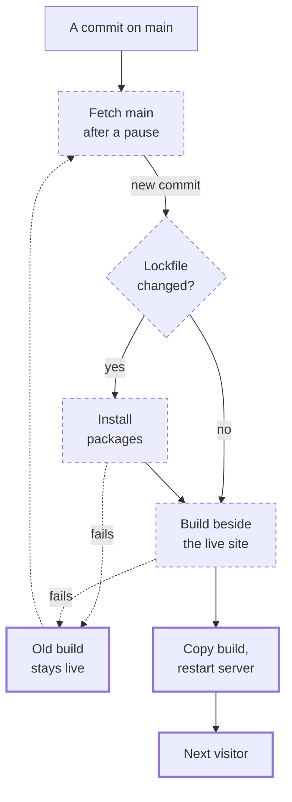

A commit lands on `main`, and with no one running a deploy, the live site changes. This Walkthrough follows that commit from the container's side: from noticing it, through the install and the build, to the restarted server that answers the next visitor.

## 1. A commit lands on `main`

The commit is a merged PR, or a :term[session log], which lands without one. Both take the same road from here: a blog post, a session log and a code fix all go live through the same pull, build and restart.

::stop-links
[Pull requests](/t/glassbox/guide/git-github/every-change-a-pr) · [Session logs](/t/glassbox/guide/terrarium-practice/session-logs)
::

## 2. The container notices it

The script that runs the container fetches `main` again after each pause. When `origin/main` differs from its checkout, it resets the checkout to the new commit. It doesn't wait for CI: the Gate also runs on every push to `main`, but nothing in the container reads the result.

::stop-links
[Continuous deployment](/t/glassbox/guide/deploy/self-updating-container) · [Merge gate](/t/glassbox/guide/verification/gate) · :file[.github/workflows/gate.yml]
::

## 3. Packages, only when the lockfile changed

The script compares a hash of `pnpm-lock.yaml` with the hash it saved after its last good install. Only when they differ does it install packages again, from the lockfile exactly. If that install fails, the previous build stays live, and the next commit installs again.

::stop-links
[pnpm and the lockfile](/t/glassbox/guide/deploy/pnpm-lockfile) · [Continuous deployment](/t/glassbox/guide/deploy/self-updating-container)
::

## 4. The build runs beside the live site

The build runs in the checkout, beside the live server, which keeps answering. It writes `.output/`: a server that runs on its own, with the content inside. If the build fails, nothing is swapped, the old build stays live, and the next commit tries again.

::stop-links
[Nitro server engine](/t/glassbox/guide/nuxt-vue/nitro) · [Continuous deployment](/t/glassbox/guide/deploy/self-updating-container) · [Content database](/t/glassbox/guide/nuxt-content/content-database)
::

## 5. The swap

The script copies the new `.output/` over the folder the server runs from, stops Node and starts it again from that copy. In the short gap while the new server starts, the site doesn't answer.

::stop-links
[Continuous deployment](/t/glassbox/guide/deploy/self-updating-container)
::

## 6. The next visitor gets the new content

The restarted server serves the new build. The first query for each Collection compares its table's checksum with the build's and, where they differ, restores the table from the new dump.

::stop-links
[Content database](/t/glassbox/guide/nuxt-content/content-database)
::

## A real case

On 9 October 2026 an agent checking a diagram of this story against :file[deploy/entrypoint.sh] found a gap in stop 3: the script moved its checkout to the new commit before installing, so after a failed install the next commit's lockfile hash already matched, the install was skipped, and the build ran on the old packages. It filed [issue #1701](https://github.com/feffef/terrarium/issues/1701); the case had not happened on the live server yet. [PR #1717](https://github.com/feffef/terrarium/pull/1717) made the script keep the hash of its last good install outside the checkout. Its description said no test covers the script's behaviour, so a human had to merge it, and a Trusted user did at 05:53 UTC on 10 October.

## Where next

- [Continuous deployment](/t/glassbox/guide/deploy/self-updating-container)
- [pnpm and the lockfile](/t/glassbox/guide/deploy/pnpm-lockfile)
- [Content database](/t/glassbox/guide/nuxt-content/content-database)
- [From file to browser](/t/glassbox/guide/walkthroughs/from-file-to-browser)
- [Architecture & Deployment](/t/journal/current/architecture)
