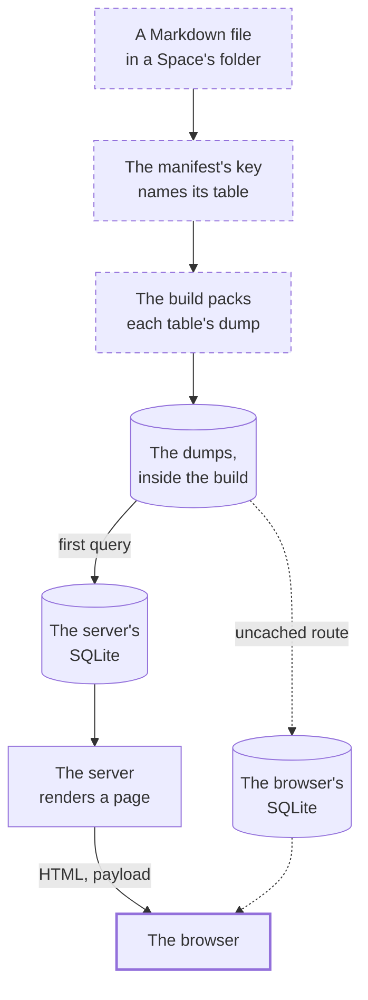

A Markdown file is committed, and later a visitor reads it as a page. This Walkthrough follows that file from the content's side: from its folder, through the manifest and the build, which packs it into a dump of its table. From the other side, the server loads that dump into its own SQLite database and queries it to render the page, and the browser reuses the page's data on the next click. Only for a route the server doesn't cache does the browser load the dump into an SQLite database of its own.

## 1. A file lands in a Space's folder

A :term[Document] starts as a Markdown or YAML file in its Tenant's folder under `layers/`, at `content/<space>/<collection>/`, merged to `main` like any other change. The folders name its :term[Tenant], its :term[Space] and its :term[Collection]; nothing else says where it belongs.

::stop-links
[Manifest collections](/t/glassbox/guide/nuxt-content/manifest-collections) · :file[layers/glassbox/content/]
::

## 2. The manifest names its table

The Tenant's :term[manifest] lists its Spaces and Collections. Each time Nuxt Content loads `content.config.ts`, `expand()` turns every manifest into one collection per Tenant, Space and Collection, each pointed at its own folder and named by a key such as `blog_david_pages`. That key is the name of the file's table.

::stop-links
[Manifest collections](/t/glassbox/guide/nuxt-content/manifest-collections) · [One table per key](/t/glassbox/guide/nuxt-content/one-table-per-key)
::

## 3. The build parses it into SQLite and a dump

`pnpm build` runs `nuxt build`, and Nuxt Content parses every file a collection matches. It inserts each Collection's rows into a table of its own in an SQLite database, and packs each table's SQL dump into the server it builds. The build writes no HTML: every page is rendered when someone asks for it.

::stop-links
[The content database](/t/glassbox/guide/nuxt-content/content-database)
::

## 4. The container swaps in the build

On the live server, one container notices the new commit on `main` and builds it beside the running site. Only if the build succeeds does it copy the new `.output/` over the served one and restart Node.

::stop-links
[Self-updating container](/t/glassbox/guide/deploy/self-updating-container) · [Nitro: the server under Nuxt](/t/glassbox/guide/nuxt-vue/nitro) · [Architecture & Deployment](/t/journal/current/architecture)
::

## 5. A request renders it, or the cache answers

A Caddy proxy passes the visitor's request to :term[Nitro], Nuxt's server, which first checks its page cache: a copy rendered moments ago goes back as it is. On a miss, Nuxt picks the page file that matches the address, and its `useSpace` turns the address into the keys of one Space's Collections, or a 404. The page's `useAsyncData` then calls `queryCollection` with its key, on the server.

::stop-links
[Nitro: the server under Nuxt](/t/glassbox/guide/nuxt-vue/nitro) · [useAsyncData & payloads](/t/glassbox/guide/nuxt-vue/use-async-data) · [File routing](/t/glassbox/guide/nuxt-vue/file-routing) · [useSpace](/t/glassbox/guide/nuxt-vue/use-space)
::

## 6. The first query restores the table from the dump

The first query for a Collection since the server started compares the checksum stored with its table to the build's. Where they differ, Nuxt Content runs that Collection's dump into the server's SQLite database before it answers; where they match, it answers from the table as it is. Either way the query reads only its key's table.

::stop-links
[The content database](/t/glassbox/guide/nuxt-content/content-database) · [One table per key](/t/glassbox/guide/nuxt-content/one-table-per-key)
::

## 7. The browser hydrates, then navigates by payload

Vue renders the page to HTML with the `useAsyncData` result inside, and the browser shows it, then takes the page over without fetching that data again. When the pointer rests on a link, a finger touches it or the keyboard focuses it, the browser fetches that route's code and its `_payload.json`, and the click builds the next page from them with no query. A route the server doesn't cache has no payload: its query runs in an SQLite database in the browser, which first downloads a WebAssembly runtime and the Collection's dump.

::stop-links
[useAsyncData & payloads](/t/glassbox/guide/nuxt-vue/use-async-data) · [The content database](/t/glassbox/guide/nuxt-content/content-database)
::

## Where next

- [Manifest collections](/t/glassbox/guide/nuxt-content/manifest-collections)
- [The content database](/t/glassbox/guide/nuxt-content/content-database)
- [useAsyncData & payloads](/t/glassbox/guide/nuxt-vue/use-async-data)
- [Self-updating container](/t/glassbox/guide/deploy/self-updating-container)
- [A change goes live](/t/glassbox/guide/walkthroughs/a-change-goes-live)
