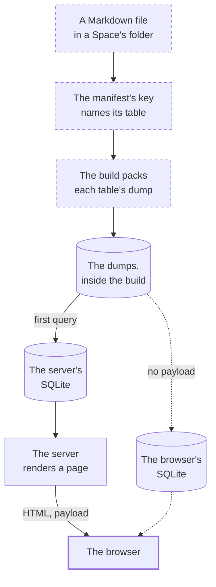

A Markdown file is committed, and later a visitor reads it as a page. This Walkthrough follows one file from its folder to the visitor's screen: through the manifest that names its table, the build that packs the table into a dump, the server that loads the dump and renders the page, and the payload the browser reuses on the next click. Only a query no payload answers (on a route the server doesn't cache, or outside `useAsyncData`) makes the browser load the dump into a database of its own.

## 1. A file lands in a Space's folder

A :term[Document] starts as a Markdown or YAML file in its Tenant's folder under `layers/`, at `content/<space>/<collection>/`, merged to `main` like any other change. Take a post in the Blog's `layers/blog/content/david/pages/`: the folders name its :term[Tenant] (`blog`), its :term[Space] (`david`) and its :term[Collection] (`pages`); nothing else says where it belongs.

::lessons
[Content collections](/t/glassbox/guide/nuxt-content/content-collections) · :file[layers/blog/content/david/pages/]
::

## 2. The manifest names its table

The Tenant's :term[manifest] lists its Spaces and Collections. Each time Nuxt Content loads `content.config.ts`, `expand()` turns every manifest into one collection per Tenant, Space and Collection, each pointed at its own folder and named by a key joined from the three names: the post's is `blog_david_pages`. That key is the name of its table.

::lessons
[Content collections](/t/glassbox/guide/nuxt-content/content-collections) · [Multi-tenant isolation](/t/glassbox/guide/nuxt-content/multi-tenant-isolation)
::

## 3. The build parses it into SQLite and a dump

`pnpm build` runs `nuxt build`, and Nuxt Content parses every file a collection matches. It inserts each Collection's rows into a table of its own in an SQLite database, and packs each table's SQL dump into the server it builds. The build writes no HTML: every page is rendered when someone asks for it. [A change goes live](/t/glassbox/guide/walkthroughs/a-change-goes-live) follows that build onto the live server.

::lessons
[Content database](/t/glassbox/guide/nuxt-content/content-database) · [Content validation](/t/glassbox/guide/verification/content-validation)
::

## 4. A request renders it, or the cache answers

A Caddy proxy passes the visitor's request to :term[Nitro], Nuxt's server, which first checks its page cache: a copy rendered moments ago goes back as it is. On a miss, Nuxt picks the page file that matches the address, and its `useSpace` turns the address into the keys of one Space's Collections, or a 404. The page's `useAsyncData` then calls `queryCollection` with its key, on the server.

::lessons
[Nitro server engine](/t/glassbox/guide/nuxt-vue/nitro) · [Data fetching](/t/glassbox/guide/nuxt-vue/data-fetching) · [File routing](/t/glassbox/guide/nuxt-vue/file-routing) · [Multi-tenant isolation](/t/glassbox/guide/nuxt-content/multi-tenant-isolation) · [queryCollection](/t/glassbox/guide/nuxt-content/query-collection)
::

## 5. The first query restores the table from the dump

The first query for a Collection since the server started compares the checksum stored with its table to the build's. Where they differ, Nuxt Content runs that Collection's dump into the server's SQLite database before it answers; where they match, it answers from the table as it is. Either way the query reads only its key's table.

::lessons
[Content database](/t/glassbox/guide/nuxt-content/content-database) · [Multi-tenant isolation](/t/glassbox/guide/nuxt-content/multi-tenant-isolation)
::

## 6. The browser hydrates, then navigates by payload

Vue renders the page to HTML with the `useAsyncData` result inside, and the browser shows it, then takes over that page without fetching its data again. When the pointer enters a link, a finger touches it or the keyboard focuses it, the browser fetches that route's code and its `_payload.json`, and the click builds the next page from them with no query. A query no payload answers runs instead in an SQLite database the browser builds from the Collection's dump.

::lessons
[Hydration](/t/glassbox/guide/nuxt-vue/hydration) · [Data fetching](/t/glassbox/guide/nuxt-vue/data-fetching) · [Content database](/t/glassbox/guide/nuxt-content/content-database)
::

## Where next

- [Content collections](/t/glassbox/guide/nuxt-content/content-collections)
- [Content database](/t/glassbox/guide/nuxt-content/content-database)
- [Data fetching](/t/glassbox/guide/nuxt-vue/data-fetching)
- [Continuous deployment](/t/glassbox/guide/deploy/continuous-deployment)
- [A change goes live](/t/glassbox/guide/walkthroughs/a-change-goes-live)
