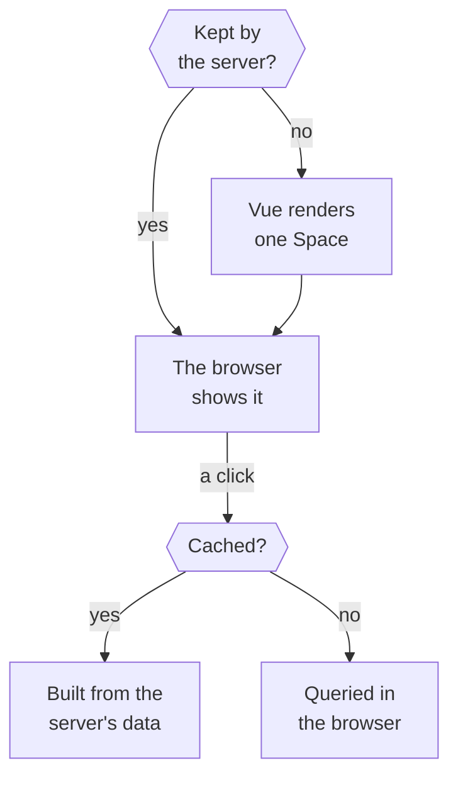

You click a link and a page appears. This Walkthrough follows that request from the visitor's side: into the one server that hosts every Terrarium site, down to the content of exactly one Space, and back to a browser that builds the next page on its own.

## 1. The request reaches the one server

The browser asks for a page under `/t/`. A Caddy proxy passes the request to the one container that serves every site, where Nuxt's server, Nitro, answers it. That container built the site from `main` itself, so all the content it can send was built before the request arrived.

::stop-links
[One app, many sites: Nuxt layers](/t/glassbox/guide/nuxt-vue/layers) · [Architecture & Deployment](/t/journal/current/architecture) · :file[deploy/README.md] · :file[docs/adr/0011-poc-self-updating-deploy-container.md]
::

## 2. The server may already have it

The server first checks its page cache. A Tenant page rendered a moment ago goes back as it is, the same copy for every visitor unless its route lists a request header it varies on, since content only changes with a new build. Only on a miss does the rest of this story run on the server.

::stop-links
:file[nuxt.config.ts] · :file[layers/tinkerfund/nuxt.config.ts] · :file[docs/adr/0028-navigation-reads-server-payloads.md]
::

## 3. The address picks one Tenant and one Space

Nuxt matches the path against its page files. The Platform's catch-all page answers any `/t/<tenant>/<space>/…` address, unless a Tenant's own layer holds a more specific page, as the Journal does. Either page calls `useSpace`, which looks the :term[Tenant] and :term[Space] up in the routing map built from the manifests, and gets back the keys of that one Space's Collections, or a 404. The bare `/t/<tenant>` above the Spaces belongs to the Tenant's own root page, if it has one.

::stop-links
[One app, many sites: Nuxt layers](/t/glassbox/guide/nuxt-vue/layers) · :file[app/pages/t/] · :file[app/composables/space.ts] · :file[shared/routing.ts] · :file[docs/adr/0006-runtime-routing-path-prefix.md] · :file[docs/adr/0016-tenant-root-layer-routes.md]
::

## 4. Nuxt Content reads that Space's tables

The page asks Nuxt Content for its Document with `queryCollection` and the key it was given. Each Tenant, Space and :term[Collection] together make one table in the server's SQLite database, so the query cannot reach another Space's content. When a Collection is asked for, the server checks its table against the build and fills it from the build's dump only if it needs to. Reading another Tenant's content takes a separate path, open only to Collections that opted in.

::stop-links
[Collections expanded from one manifest](/t/glassbox/guide/nuxt-content/manifest-collections) · [Reading across Tenants through opted-in kinds](/t/glassbox/guide/terrarium-practice/cross-tenant-kinds) · :file[shared/expand.ts] · :file[content.config.ts] · :file[docs/adr/0001-single-container-baked-multitenancy.md]
::

## 5. Vue renders the page, data inside

Vue renders the page to HTML on the server. `ContentRenderer` turns the Document's stored body into components: a prose component for each Markdown element, the component each MDC block names, and the committed SVG of each Mermaid diagram. Whatever the page's `useAsyncData` returned travels with it, so the browser shows the page at once. Then Vue takes over in the browser, and later clicks no longer reload the whole page.

::stop-links
[MDC components, and when not to use them](/t/glassbox/guide/nuxt-content/mdc-components) · [Overriding prose components](/t/glassbox/guide/nuxt-content/prose-overrides) · [Mermaid pre-rendered to committed SVG](/t/glassbox/guide/nuxt-content/mermaid-svg) · :file[docs/adr/0028-navigation-reads-server-payloads.md]
::

## 6. A hover fetches the next page's data

When the pointer rests on a link, a finger touches it or the keyboard focuses it, the browser fetches that route's code and, for a cached route, its `_payload.json`: the data the server rendered for it. A link that merely scrolls into view fetches nothing.

::stop-links
:file[nuxt.config.ts] · :file[docs/adr/0028-navigation-reads-server-payloads.md]
::

## 7. The click builds the next page

Usually the route is cached, so the browser builds the page from its payload and runs no query. A page that opts out of the cache, like Tinkerfund's search, has no payload: its query runs in a database inside the browser, which first downloads the SQLite runtime, compiled to WebAssembly, and the dump of each Collection it queries. The same browser database steps in when a payload fails to load. If a download fails, the page reloads once; a second failure, or any other kind, shows a dialog that offers a reload.

::stop-links
:file[layers/tinkerfund/nuxt.config.ts] · :file[app/composables/contentLoadRecovery.ts] · :file[docs/adr/0019-patched-nuxt-content-client-db-loading.md]
::

## Where next

- [One app, many sites: Nuxt layers](/t/glassbox/guide/nuxt-vue/layers)
- [Collections expanded from one manifest](/t/glassbox/guide/nuxt-content/manifest-collections)
- [MDC components, and when not to use them](/t/glassbox/guide/nuxt-content/mdc-components)
- [Overriding prose components](/t/glassbox/guide/nuxt-content/prose-overrides)
- [Mermaid pre-rendered to committed SVG](/t/glassbox/guide/nuxt-content/mermaid-svg)
- [Reading across Tenants through opted-in kinds](/t/glassbox/guide/terrarium-practice/cross-tenant-kinds)
