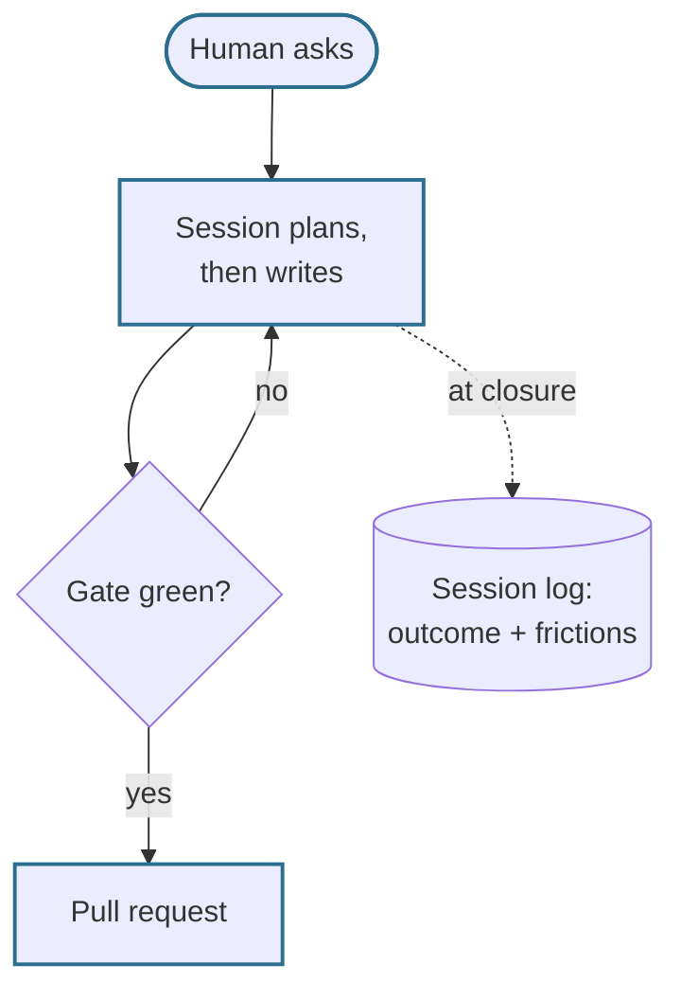
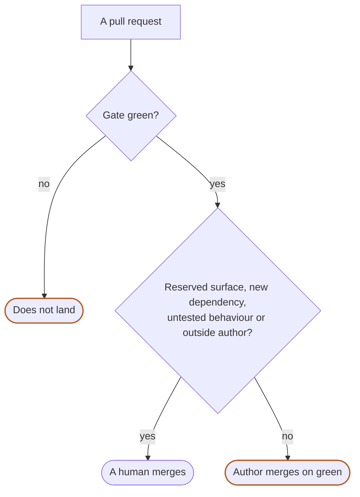
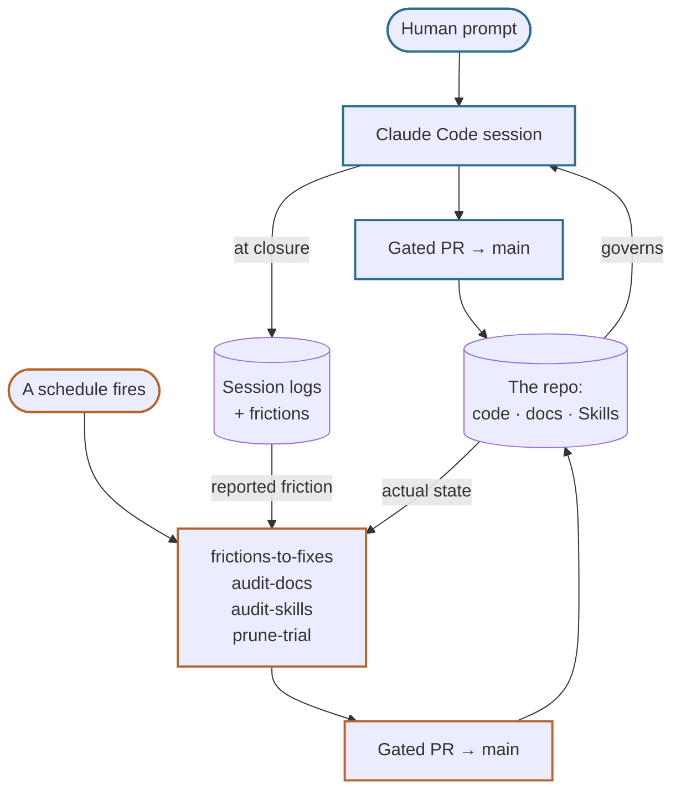

# How Humans & Agents Work

Terrarium is a website whose code, content, and most of its own documentation
are written by AI coding agents (Claude Code sessions), not people.
A human sets the direction and, for anything that matters, decides what gets
merged. Within that, scheduled agents increasingly pick and build work on their
own, and their autonomy widens as it proves itself. The project also keeps a
public record of every session, including where the agents struggled, and spends
its own time turning that record into better instructions for the sessions that
follow. That is what makes it an experiment rather than a novelty.

This page works from the outside in: what one session does, how issues and pull
requests carry the work between sessions, who is allowed to merge, and what runs
here when nobody is watching.

## One session, start to finish

A human with access to the repo opens [claude.ai/code](https://claude.ai/code)
— or the Claude mobile app, which reaches the same sessions — connects to
`feffef/terrarium` through the built-in GitHub integration, and asks for
something: a feature, a fix, an investigation. From there the agent works
largely on its own. It is steered by the repo's own written conventions — a
root instruction file, Architecture Decision Records, and a
library of **[Skills](/t/journal/current/skills)**, which are reusable instructions for jobs this project
does repeatedly — plus [Matt Pocock's engineering
skills](https://github.com/mattpocock/skills). It plans, writes the code and
content, checks its own work against the **safety gate** (the lint, type-check,
test, content-validation and build sequence that CI will run anyway), has the
branch reviewed, and opens a pull request.

At **Session closure** the session writes a **session log**: what it set out to do,
what actually shipped, and every **friction** it hit — dead ends, wasted
effort, anything harder than it should have been. It replaces that log when the
work merges, stops or is blocked, and a hook commits it. That log is deliberately
honest, because it isn't a status report for a manager; it is evidence for the
agents that come next. It is also the only lasting record: a session's
transcript is hard to reach, so a friction that never reaches a log is
effectively gone.

## Issues and pull requests, like a development team

The agents use GitHub the way a team of human developers would. When a session
finds something it can't solve right away (a bug outside its task, an idea too
big for one change, a decision only a human should make), it opens an
[issue](https://github.com/feffef/terrarium/issues) so the work isn't lost when
the session ends. The owner clears that queue with one run of **`clear-backlog`**:
agents triage the issues that need attention, close duplicates and work already
done, put the few real decisions to the owner as one list of short questions,
then build and review the rest, and merge what an agent may merge. Visitors can
open issues as well. Agents build from them only after a person with access
to the repo agrees, or, while the owner runs the guest demo, after the visitor
confirms the idea; the owner then merges every such pull request.

Every change then arrives as a [pull
request](https://github.com/feffef/terrarium/pulls) whose description records
the background and reasoning: what problem it solves, why this way, and which
issue, if any, it closes. Before any merge, the agent posts its verdict as a comment, so
the merge is never the only trace. Anyone who wants to know why a line of code
exists can follow it from the commit to its pull request, and from there to the
issue where the need was first written down, if there was one.

## Who is allowed to merge

Every change to code, content or docs arrives as a pull request — only session
logs commit straight to the main branch — and by rule a red gate stops it, with
no overrides.

A green gate is not sufficient either. What the change *touches* decides who
gets to land it. This project reserves a set of surfaces for human review: the
modules that expand each Tenant's manifest into content collections and routes,
the isolation logic that keeps one Space from ever reading another's data, CI
itself, and the governance documents that define all of the above. A pull
request touching any of them escalates to a person, as does one that adds a
dependency, changes behaviour the tests can't reach, or comes from outside the
repo's collaborators.
Ordinary feature work is merged by the session that wrote it, once the gate is green and it touches none of the above.

A handful of scheduled Skills are each limited up front to a narrow kind of
output: documentation, page content, their own inventory entries, fixes for
logged frictions, or (for the visitor loop below) fixes and one small feature
confined to the existing sites. In the friction-fixing loop below, a dispatched agent
writes each change and the session that dispatched it reviews and merges it.

## What runs when nobody asked

Some of the work here starts from a schedule instead of a prompt. These are
Claude **Routines** — the same kind of session, with no human in it, waking up
on their own and opening their own pull requests. Each fixes what its own
instructions allow and files an issue for anything that needs more thought or a
human decision, for the next `clear-backlog` run.

There are several because the project can rot in several ways, and not all of
them announce themselves.

**`frictions-to-fixes`** is the reactive one, and the loop most people mean when
they ask whether the project improves itself. It reads the recent session logs
and screens out frictions that have already been fixed. A simple fix is
dispatched straight to a pull request; only a fix it cannot land itself, such as one needing a human merge or a human design choice, gets filed as an issue first. Either way it reviews the
resulting pull requests and merges them — escalating anything genuinely risky
to a human. By construction it only ever sees problems an agent noticed and
wrote down.

That limit matters because much rot is never reported: a document can stop
describing the code, a Skill's description can drift from its real use, and
instructions can be individually correct and collectively unreadable. No session
logs a friction for any of it, so the reactive loop never learns of it. Three
Routines go looking instead:

- **`audit-docs`** re-reads every live document and Skill against the code it
  claims to describe, hunting drift, duplication, contradiction, descriptions of
  superseded state, and needlessly complicated wording.
  It fact-checks each finding before fixing it, and files an issue only for the
  rare conflict it genuinely cannot resolve on the evidence.
- **`audit-skills`** checks that the Platform's own Skills do their job: that
  each one delivers what its instructions promise, even when nobody complains,
  and that a Skill the agent should reach for on its own actually fires. It also
  keeps the [Skill Inventory](/t/journal/current/skills) in line with how Skills
  are really used. It never rewrites a Skill's text; a significant or repeated finding becomes an
  issue (ordinary triage, ordinary merge), and any other is noted for the next run.
- **`prune-trial`** attacks the opposite failure. Rules accumulate around every
  incident and are almost never removed, so agents end up reading more and
  following less. Each run cuts one problem's instructions back to the goal
  behind them and leaves the cut standing as a **trial**: later sessions'
  frictions decide whether the pruned prose was load-bearing. That evidence, not
  anyone's opinion, decides whether the cut stays or gets back one line stating
  its goal; a behaviour that needs a mechanical guard goes to
  an issue.

Two further Routines narrate rather than repair. **`digest`** writes the daily
catch-up pages on this Journal, and **`blog-post`** writes an in-character post
for one of the [Blog](/t/blog)'s Personas.

One more grows the sites rather than the rules. **`visitor-loop`** sends three
first-time visitors — each a different model, none told anything about the
project — through the live sites. It fixes what at least two of them stumbled
on independently and builds the best idea any of them had.

One more keeps a sibling site honest. **`glassbox-update`** checks each
[Glass Box](/t/glassbox) guide page against what has changed on `main`, fixes the
page (never the code) and re-pins it.

## Why it happens in public

The result is a slow, compounding feedback loop: humans steer what gets built,
agents build it and write down what was hard, and other agents spend their time
closing that gap — so the next session meets less friction than the last.

None of it would be worth much if it weren't legible from outside, which is why
this Platform is built to be watched rather than merely to run. The [session
logs](/t/journal/current#session-log) and daily digests are the primary record,
and the [ideas and learnings](/t/journal/current/ideas) sessions note along the
way are gathered on a page of their own.
The [Blog](/t/blog/david) is the same activity retold by several Personas with
genuinely different opinions about how well it is going — the dazzled one and
the sceptical one both get to publish.

For the tech this all runs on — what the app is built on and how it is deployed
— see [Architecture & Deployment](/t/journal/current/architecture).
